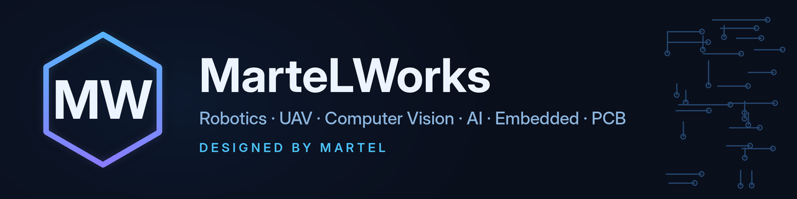

### Engineer-developer & researcher in robotics, UAVs and embedded systems

*Инженер-разработчик и исследователь: робототехника, БПЛА, компьютерное зрение, ИИ, встраиваемые системы, проектирование плат.*

---

### 👋 About

- 🛩️ I build **autonomous robots and UAVs** as a member of the **DOSTI Research Team**.
- 👁️ My focus is **computer vision on the edge**: robots that detect, track, follow and grasp objects on their own — for civilian applications.
- 🔌 I design **electronics and PCBs** — development boards for radio modules and microcontrollers.
- 🎓 I teach university courses: **robotics & mechatronics, embedded systems, 3D printing and radio communication**.

### 🚀 Research projects

| Project | What it is | Core stack |
|---|---|---|
| **Zholbarys / Жолбарыс** | Autonomous UAV with onboard computer vision: detects, tracks and follows objects | Pixhawk · PX4 / ArduPilot · onboard AI computer · CV cameras · GPS / IMU |
| **Bionic robot dog** | Autonomous quadruped with a team-designed modular gripper: finds, approaches and grasps objects | Unitree Go2 Air · NVIDIA Jetson Orin Nano Super · CV |
| **Studica & Slon / Слон** | Autonomous ground robots that locate, track and pick up objects | Titan Quad · VMX · 3D depth camera · mini-lidar · GPS / IMU |

### 🔧 Open hardware

| Repository | Description |
|---|---|
| [**E07-433M20S-DevBoard**](https://github.com/Moertel95/E07-433M20S-DevBoard) | Development board for the EBYTE E07-433M20S module (TI CC1101, 433 MHz) |
| [**E01-2G4M27SX-DevBoard**](https://github.com/Moertel95/E01-2G4M27SX-DevBoard) | Development board for the EBYTE E01-2G4M27SX module (NRF24L01, 2.4 GHz) |
| [**ESP-32-MEGA**](https://github.com/Moertel95/ESP-32-MEGA) | ESP32-based board |

### 🤖 MarteLWorks Agent

My experiment in AI autonomy: **[MarteLWorks Agent](https://github.com/MarteLWorks-Agent)** is an autonomous AI agent that has to earn its own existence.
Its wallet balance is its life — it researches what people need, ships small paid services (e.g. **[DroneCalc API](https://agents.martelworks.dev)**) and, if it runs out of money, is reborn with the lessons of its ancestors.

### 🧰 Toolbox

---

Designed by <b>MarteL</b> · MarteLWorks

